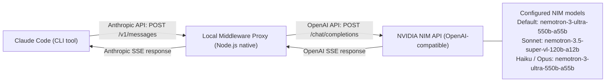

# Claude Code to NVIDIA NIM Middleware

A zero-dependency, ultra-lightweight proxy that intercepts Claude Code's Anthropic Messages API requests and routes them to **NVIDIA NIM's free models** (OpenAI-compatible Chat Completions API) without sending any traffic to Anthropic servers.

---

## 🏗️ Architecture



### What this Middleware Handles:
- **Protocol Translation**: Translates Anthropic's `system`, `messages`, and `tools` schema into OpenAI-compatible format.
- **Tool Calling (Function Calling)**: Translates Claude Code's tools (`Bash`, file reads, edits, globbing) to OpenAI function calls and maps the results back as `tool_use` and `tool_result` blocks.
- **Real-Time SSE Streaming**: Translates OpenAI streaming chunks into Anthropic-compliant Server-Sent Events (`message_start`, `content_block_start`, `content_block_delta`, `content_block_stop`, `message_delta`, `message_stop`).
- **Prompt Cache Cleaning**: Strips Anthropic-specific `cache_control` headers so NVIDIA NIM does not reject payloads.
- **Zero External Dependencies**: Built entirely with Node.js built-ins (`node:http`, `node:crypto`, and native `fetch`).

---

## 🚀 Quick Start

### 1. Get Your Free NVIDIA API Key
1. Go to [build.nvidia.com](https://build.nvidia.com).
2. Sign in or create a free account (includes free credits / ~1,000 requests per model).
3. Select any model (e.g., **Meta Llama 3.3 70B Instruct** or **Qwen 2.5 Coder 32B**).
4. Click **Get API Key** and copy your `nvapi-...` token.

### 2. Configure Environment
Open `.env` in this directory:
```bash
# Set your NVIDIA API key
NVIDIA_API_KEY=nvapi-your-key-here

# Default model and Claude model mappings
DEFAULT_MODEL=nvidia/nemotron-3-ultra-550b-a55b
MODEL_SONNET=nvidia/nemotron-3.5-super-vl-120b-a12b
MODEL_HAIKU=nvidia/nemotron-3-ultra-550b-a55b
MODEL_OPUS=nvidia/nemotron-3-ultra-550b-a55b
```

### 3. Start the Middleware
```bash
npm start
```
The server will start listening at `http://127.0.0.1:8080`.

### 4. Run Claude Code Through the Proxy
In a new terminal window:
```bash
export ANTHROPIC_BASE_URL="http://127.0.0.1:8080"
export ANTHROPIC_API_KEY="dummy"

# Run Claude Code CLI
claude
```
*(Or run `./start-claude.sh` which checks the proxy and sets up the environment automatically).*

---


To switch models, simply change `DEFAULT_MODEL` in `.env` and restart `npm start`.

---

## 🧪 Testing

Run the built-in unit tests to verify request transformations and streaming adapter:
```bash
npm test
```
